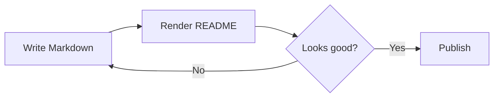
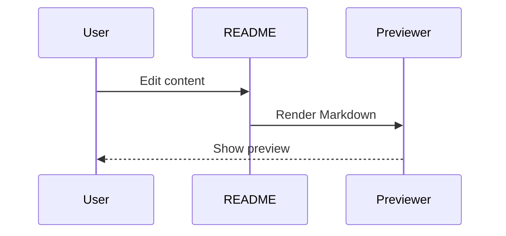

# ✨ README Playground

> A deliberately fancy README for testing Markdown renderers, Git hosting platforms, documentation themes, and preview components.

<p align="center">
  
</p>

<p align="center">
  <strong>One README. Many Markdown features. Zero dependencies.</strong>
</p>

# 1234
<p align="center">
  <a href="#features">Features</a> ·
  <a href="#quick-start">Quick start</a> ·
  <a href="#usage">Usage</a> ·
  <a href="#contributing">Contributing</a>
</p>

<p align="center">
  
  
  
  
</p>

---

## 📚 Table of contents

- [About](#-about)
- [Features](#-features)
- [Quick start](#-quick-start)
- [Usage](#-usage)
- [Configuration](#️-configuration)
- [Project structure](#-project-structure)
- [Roadmap](#-roadmap)
- [FAQ](#-faq)
- [Contributing](#-contributing)
- [License](#-license)

## 🧭 About

**README Playground** is a fictional project used to test rich README rendering. It includes headings, links, images, badges, tables, code, equations, diagrams, alerts, keyboard shortcuts, and interactive HTML elements.

> [!NOTE]
> This is sample content. Replace the URLs, commands, branding, and project details with your own.

## 🚀 Features

| Feature | Status | Example |
|---|:---:|---|
| Markdown headings | ✅ | `# Heading` |
| Syntax highlighting | ✅ | JavaScript, Python, JSON |
| Tables | ✅ | Alignment and inline formatting |
| Mermaid diagrams | ✅ | Flowcharts and sequences |
| Math notation | ✅ | `$E = mc^2$` |
| Collapsible content | ✅ | `<details>` blocks |
| Task lists | ✅ | `- [x] Complete` |
| Footnotes | ✅ | Reference-style notes[^1] |

## ⚡ Quick start

```bash
git clone https://github.com/example/readme-playground.git
cd readme-playground
npm install
npm run dev
```

Then open <http://localhost:3000> in your browser.

### Requirements

- Node.js `>= 20`
- npm `>= 10`
- A modern browser

## 💻 Usage

```javascript
import { greet } from "readme-playground";

const message = greet("world");
console.log(message);
// Hello, world! 👋
```

```python
from readme_playground import greet

print(greet("world"))
```

### API example

```http
GET /api/greet?name=world HTTP/1.1
Host: localhost:3000
Accept: application/json
```

```json
{
  "message": "Hello, world! 👋",
  "requestId": "req_01HAPPYREADME",
  "cached": false
}
```

## ⚙️ Configuration

Create a `.env` file:

```dotenv
APP_PORT=3000
APP_ENV=development
ENABLE_EXPERIMENTAL_FEATURES=true
```

| Variable | Default | Description |
|---|---:|---|
| `APP_PORT` | `3000` | Local HTTP port |
| `APP_ENV` | `development` | Runtime environment |
| `ENABLE_EXPERIMENTAL_FEATURES` | `false` | Enables preview functionality |

## 🌳 Project structure

```text
readme-playground/
├── .github/
│   └── workflows/ci.yml
├── src/
│   ├── index.js
│   └── utils.js
├── tests/
│   └── index.test.js
├── .env.example
├── package.json
└── README.md
```

## 🔄 How it works





## 📐 Math and notation

Inline math: `$a^2 + b^2 = c^2$`

Block math:

$$
\text{quality} = \frac{\text{clarity} \times \text{usefulness}}{\text{confusion} + 1}
$$

> [!TIP]
> Keep the first screen of your README focused on what the project does and how to run it.

> [!WARNING]
> Never commit secrets, API keys, private tokens, or production credentials.

## 🗺️ Roadmap

- [x] Add a polished introduction
- [x] Demonstrate tables and badges
- [x] Add code samples
- [x] Add Mermaid diagrams
- [ ] Add real project screenshots
- [ ] Add benchmark results
- [ ] Publish a live demo

<details>
<summary>Click to expand advanced details</summary>

### Rendering notes

Different platforms support different subsets of Markdown. Mermaid, alerts, LaTeX, HTML, and alignment syntax may require platform-specific support.

```bash
# Run a local Markdown previewer
npx @marp-team/marp-cli README.md --html
```

</details>

## ❓ FAQ

<details>
<summary>Is this a real production project?</summary>

No. It is a reusable test document for README renderers and Markdown previews.

</details>

<details>
<summary>Can I copy sections from this file?</summary>

Yes. Copy, adapt, and remove any sections that do not fit your project.

</details>

## 🤝 Contributing

1. Fork the repository.
2. Create a branch: `git checkout -b docs/improve-readme`
3. Make your changes.
4. Run the checks:

   ```bash
   npm test
   npm run lint
   ```

5. Open a pull request with a clear description.

Please follow the project's code of conduct and keep examples accessible, accurate, and easy to copy.

## 📄 License

Distributed under the MIT License. See [`LICENSE`](LICENSE) for details.

## 🔗 Links

- 🌐 [Documentation](https://example.com/docs)
- 🐛 [Issue tracker](https://github.com/example/readme-playground/issues)
- 💬 [Community discussions](https://github.com/example/readme-playground/discussions)
- 📦 [Package registry](https://www.npmjs.com/)

---

<p align="center">
  Made with curiosity, Markdown, and too many emojis · <kbd>Ctrl</kbd> + <kbd>F</kbd> to explore
</p>

[^1]: Footnotes are supported by many Markdown implementations, but not all.
